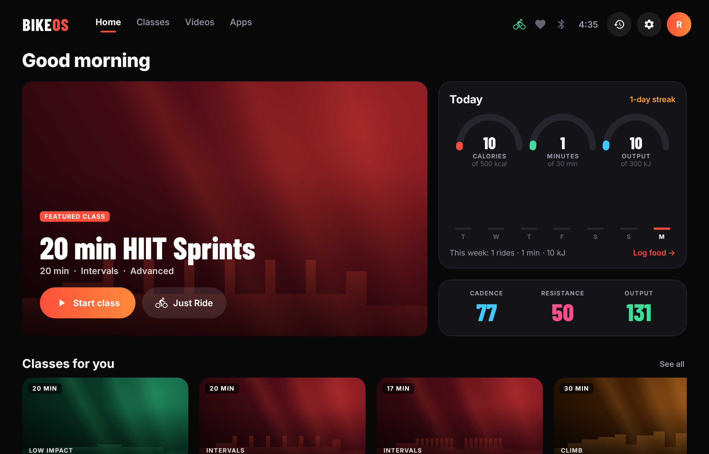
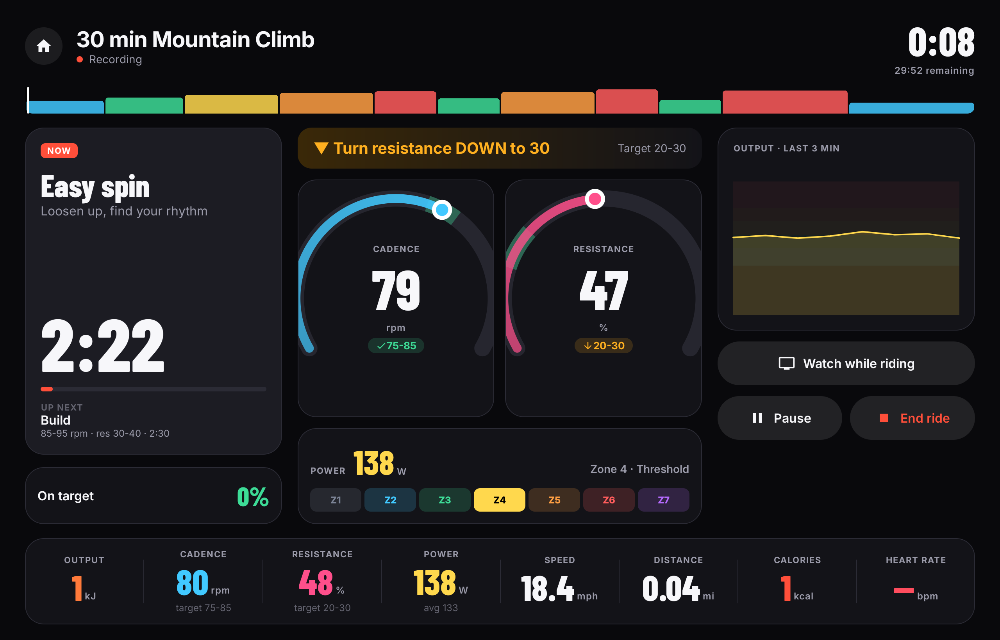
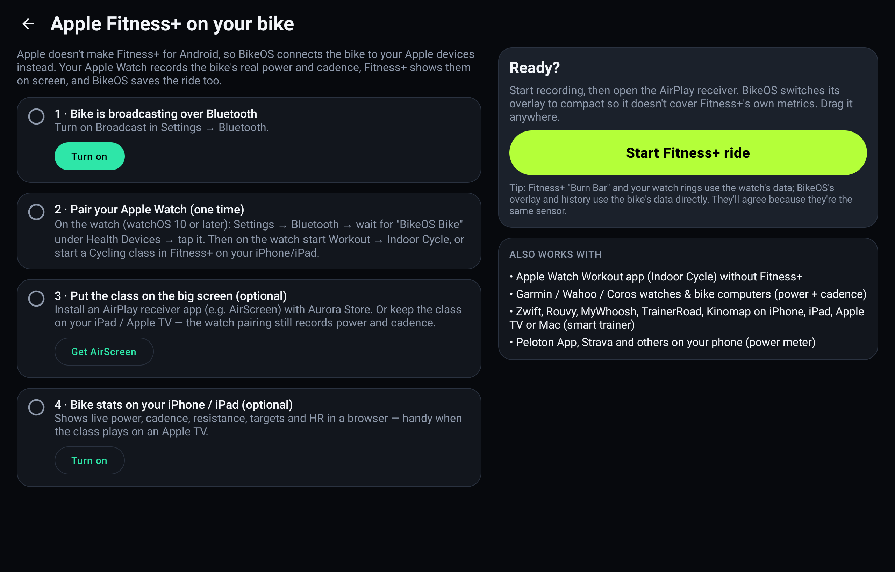
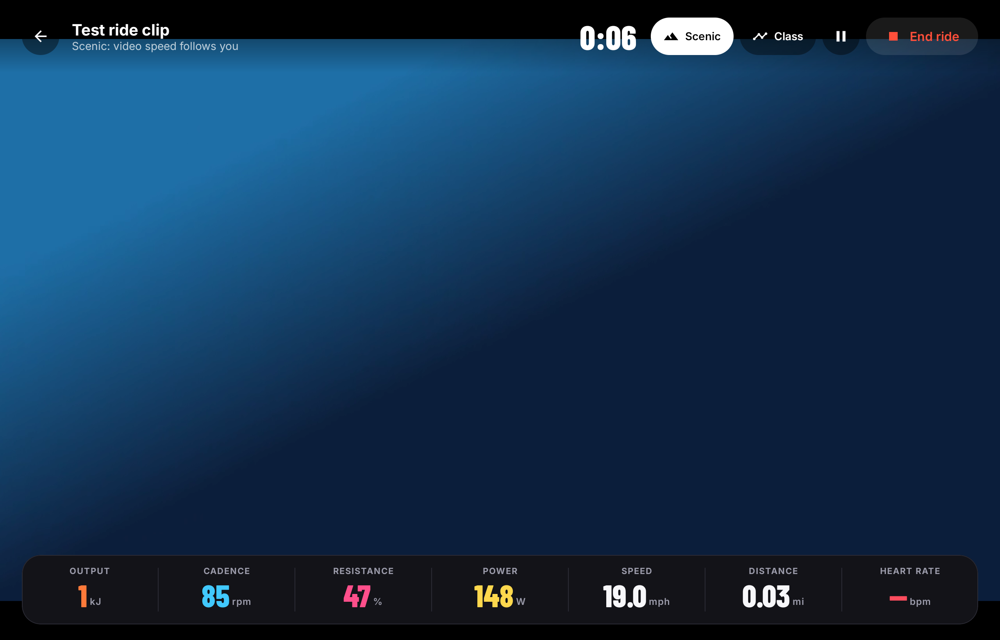

# BikeOS

**A replacement home screen ("OS shell") for the Peloton Bike and Bike+.** You can use any fitness subscription or app, and your bike's resistance, cadence and power are tracked the whole time.

- **Use any app while you ride:** YouTube, YouTube TV, Twitch, Netflix, Spotify, MyFitnessPal, Zwift, Strava, Apple Music, Prime Video, Disney+, Max, Plex and others. If an app isn't installed, BikeOS opens its website in a built-in browser instead.
- **Live stats float over every app:** time, power and zone, cadence, resistance, output (kJ), speed, distance, calories and heart rate.
- **Ride tracking that just works:** a ride starts recording after a few seconds of pedaling, in any app, and saves itself when you stop. You get history, charts, best efforts, streaks and **TCX export** for Strava, Garmin Connect, TrainingPeaks and intervals.icu.
- **Peloton-style resistance features:**
  - Live resistance readout from the bike (0-100).
  - Structured classes with **cadence and resistance target ranges**, countdowns, cues and an on-target score.
  - **Power Zone** training (7 zones from your FTP) and a **20-minute FTP test** that updates your zones automatically.
  - Resistance coaching: BikeOS learns how your bike's resistance maps to power, then tells you "▲ turn up to 42". On a **Bike+** it can drive the resistance motor itself (experimental, see below).
- **Bring other subscriptions:** BikeOS shows up over Bluetooth as a **smart trainer (FTMS)** and a **power meter (Cycling Power)**:
  - **Zwift, Rouvy, MyWhoosh, Kinomap, TrainerRoad:** pair "BikeOS Bike". ERG mode (target watts) and SIM mode (hills) become resistance prompts, or automatic resistance on a Bike+.
  - **Apple Fitness+ / Apple Watch:** pair "BikeOS Bike" as a power meter on the watch (watchOS 10+). Indoor Cycle workouts then record real power and cadence. Fitness+ itself only exists on Apple devices, so you AirPlay or mirror the class onto the bike screen with an AirPlay receiver app. The Fitness+ tile walks you through it.
- **Heart-rate straps:** connect any standard Bluetooth HR monitor.
- **Second screen:** an optional Wi-Fi dashboard so any phone or iPad can show your live bike stats.
- **Built to be safe:** BikeOS only makes allowlisted read-only calls to Peloton's service, caps and rate-limits any motor control, has a safe mode for crash loops, and never modifies Peloton's software (see [Safety](#safety-bikeos-wont-break-your-peloton)).



| A class in progress | Apple Fitness+ setup |
|---|---|
|  |  |

*Screenshots are captured automatically by CI on a tablet-sized Android 10 emulator with the built-in bike simulator.*

> BikeOS is independent software. It is not affiliated with or endorsed by Peloton. It relies on undocumented interfaces that a Peloton software update can change at any time.

---

## Safety: BikeOS won't break your Peloton

BikeOS is built so it can't damage the bike or leave it unusable:

| Risk | What BikeOS does about it |
|---|---|
| Changing Peloton's software | Never. It doesn't modify, disable, update or uninstall any Peloton package. The Peloton app stays installed and is one tap away (**Settings → Safety & Peloton → Open Peloton app**). |
| Calling the wrong function on Peloton's sensor service (e.g. calibration, firmware) | Every Binder call goes through an **allowlist** (`PelotonCallPolicy`): register/unregister a listener, and read bike data. Anything else is refused before it's sent. Unit-tested against every other transaction number. |
| Bike+ resistance motor | Off by default. When enabled it is limited (`ResistanceLimiter`, unit-tested): a user ceiling (default 75), at most 10 points per step and one step per second, **never increases while you aren't pedaling or if sensor data is stale**, only runs on a real Bike+ (`PLTN-TTR01`), and switches itself off after 3 errors. |
| BikeOS crashing as the home screen | A crash guard hands the screen back to the Peloton app. After 3 crashes in 2 minutes BikeOS starts in **safe mode**: it touches no sensors, Bluetooth or motor, and offers "Open Peloton", "Try again" and "Reset settings". |
| Tablet-wide Bluetooth name | Not changed by default. The custom name is opt-in, the original name is saved first, and it's restored automatically (or via **Restore Bluetooth name**). |
| Getting stuck | `adb uninstall com.bikeos` returns the bike to stock. Peloton becomes the home screen again automatically, and your Peloton account and data are untouched. |

### Bike check: BikeOS reads Peloton's own code before talking to the bike
At startup, BikeOS reads (never modifies) the installed APK of Peloton's sensor service. Installed APKs are readable by any app, so no root is needed. It parses the code (DEX), confirms the Binder interfaces it relies on exist on **your** firmware, and reads the real transaction numbers from Peloton's AIDL stubs:
- If a Peloton update **renumbered** a call, BikeOS adapts automatically. The safety allowlist follows the adapted numbers, so it still only allows those specific named calls.
- If an interface is **missing**, BikeOS tries the other sensor interfaces instead of failing.
- On a **Bike+**, it looks for the set-resistance call by name (`setResistance` / `setTargetResistance`…). Settings → Bike sensor shows it with a **Use it** button, so no guessing is needed. It's never auto-enabled, and never picked if the name doesn't clearly mean "set resistance" (e.g. calibration calls are excluded).

Results are under **Settings → Bike sensor → Bike check**.

### How it's tested
- **43 JVM unit tests** (`./gradlew :core:test`): sensor parcel decoding, ride maths, power zones, workouts, Bluetooth FTMS/CPS/CSC encoding, TCX export, the safety allowlist, the resistance limiter, the DEX scanner (including obfuscated and renumbered code) and the Wi-Fi dashboard.
- **On-device tests on Android emulators matching the Peloton tablets**: API 25 / Android 7.1 (Bike) and API 29 / Android 10 (Bike+), on a tablet-sized screen, run in CI on every push. They:
  - check that the scanner reads **real AIDL compiler output** correctly
  - check that the guard blocks every non-allowlisted call before it is sent
  - check that motor control can't be created off a Bike+
  - open every main screen
  - ride for over a minute on the simulator, then check the ride is recorded, saved and exported to TCX
  - check that pedaling auto-starts a ride and that the Wi-Fi dashboard serves live data

What the tests **can't** cover is Peloton's real sensor service, which only exists on the bike. That's what the bike check is for.

What BikeOS **can't** promise: a future Peloton OTA update may change the sensor service so BikeOS stops seeing data. That doesn't harm the bike. Settings → Bike sensor shows the status. Peloton also restricts sideloading on newer OS versions to active members, and installing third-party apps is your own choice and responsibility.

## What "a new OS" means here (and what it doesn't)

The Peloton tablet runs a locked-down build of Android, with Peloton's app acting as the home screen. BikeOS **replaces that home screen and the experience on top of it**. It does not reflash the tablet.

| Layer | Stock Peloton | With BikeOS |
|---|---|---|
| Bootloader, kernel, Android | Peloton | Unchanged (Peloton) |
| Sensor service (`com.onepeloton.affernetservice`) | Peloton | Unchanged. BikeOS reads data from it |
| Home screen / launcher | Peloton app | **BikeOS** |
| Classes | Peloton membership | Any app, BikeOS workouts, Zwift, Apple Fitness+ via AirPlay… |
| Ride tracking | Peloton app | **BikeOS** (plus TCX export) |

A true custom ROM would mean unlocking a signed bootloader and could permanently brick the bike, and you'd lose the sensor service that talks to the flywheel electronics. The launcher approach keeps the bike safe and fully reversible. Uninstalling BikeOS gives you the stock bike back.

### How the sensor data is read (reverse-engineering notes)

The bike's sensor board connects to the tablet over a serial link that only system apps can open. Peloton's own system service reads it and exposes the data over Android Binder. BikeOS speaks that service's protocols directly. The protocol details below were documented by the open-source community (the [Grupetto](https://github.com/selalipop/grupetto) and [PeloMon](https://github.com/ihaque/pelomon) projects):

| Bike | Interface | How BikeOS uses it |
|---|---|---|
| Bike (current OS) | `com.onepeloton.affernetservice.IV1Interface` | `registerCallback` (tx 1). `IV1Callback.onSensorDataChange` (tx 1) pushes a `BikeData` parcel |
| Bike+ (`PLTN-TTR01`) | `com.onepeloton.affernetservice.IBikeInterface` | Polls tx 14 four times a second for a `BikeData` parcel |
| Bike (older OS) | `com.peloton.service.SensorData` Messenger | Repeating requests 1/2/3 (rpm, power, resistance) |

`BikeData` gives rpm, power in centiwatts and resistance. The parcel decoder is in `core/src/main/kotlin/com/bikeos/core/peloton/PelotonBikeData.kt`, with unit tests. Speed is derived from power using PeloMon's regression, the same way the Peloton app does it. BikeOS also filters out the one-sample resistance spikes the ADC produces.

---

## Install

### 1. Get the APK
Every push builds the APKs on GitHub Actions. Open the repo's **Actions** tab, click the latest **Build BikeOS** run, and download the **BikeOS-apk** artifact (`BikeOS-release.apk`).

Or build it yourself (JDK 17 and the Android SDK are required):
```bash
./gradlew :app:assembleRelease      # → app/build/outputs/apk/release/app-release.apk
```

### 2. Sideload it onto the bike
Peloton tablets don't have Google Play. You need ADB access. The community guide is the r/pelotoncycle wiki ("howto/root"). It explains how to enable developer options/ADB on your bike's OS version. Note: Peloton has put sideloading behind an active membership on recent OS versions. Once BikeOS is installed it doesn't need one.

```bash
adb install -r BikeOS-release.apk
```

### 3. One-time setup (over ADB, because Peloton hides Android Settings)
```bash
# Let the stats overlay draw on top of other apps
adb shell appops set com.bikeos SYSTEM_ALERT_WINDOW allow

# Make BikeOS the home screen
adb shell cmd package set-home-activity com.bikeos/.ui.HomeActivity

# Allow Bluetooth scanning for heart-rate straps (or tap "Allow Bluetooth" in BikeOS)
adb shell pm grant com.bikeos android.permission.ACCESS_FINE_LOCATION
```
If `set-home-activity` isn't available on your OS version, press the Home button and choose **BikeOS → Always**.

To go back to stock at any time: `adb uninstall com.bikeos`.

### 4. Install the apps you want
Use **Aurora Store** (an anonymous Google Play client) or sideload APKs with `adb install`. Apps that need Google sign-in (YouTube, YouTube TV) may also need microG. Until an app is installed, its tile opens the web version in the BikeOS browser. The browser supports protected video and has a desktop-site toggle, which YouTube TV and Spotify Web need.

---

## Using it

- **Just pedal.** After 3 seconds a free ride starts recording. Open YouTube or Netflix from the home screen and the stats overlay stays on top. Stop pedaling for 3 minutes (configurable) and the ride ends and saves itself.
- **Workouts:** HIIT, Tabata, climbs, endurance, low impact, Power Zone Endurance/Max and the FTP test. Start one, then tap **Watch something while riding**. Targets, countdowns and resistance prompts follow you into any app.
- **Overlay:** drag it by the handle. ⤡ switches to compact mode, ⏸ pauses, ■ ends (tap twice), and 🏠 goes back to BikeOS.
- **History:** charts, best 1/5/20 min power, **Share TCX** (to Strava/Drive/email) or **Save file** (to `/sdcard/Android/data/com.bikeos/files/exports`, then `adb pull`).
- **MyFitnessPal:** the home screen shows calories burned today, with a button that opens MyFitnessPal so you can log them.

### Zwift and other training apps
1. In BikeOS Settings → Bluetooth, make sure **Broadcast** is on.
2. In Zwift's pairing screen, choose **BikeOS Bike** for Power Source, Cadence and Controllable.
3. In SIM mode, hills become resistance prompts. Tune them under "Hill feel" (flat-road resistance and resistance per 1% grade). ERG targets become "turn to NN" prompts based on your bike's learned resistance curve.

Zwift and similar apps can run on the bike itself or on another device, such as a phone, Apple TV or laptop.

### Apple Fitness+ and Apple Watch
Apple only makes Fitness+ for iPhone, iPad and Apple TV, so there's no Android app to install. Tap the **Apple Fitness+** tile to open a setup screen with a live checklist:

1. **Bike broadcasting.** BikeOS appears as a Bluetooth **power meter + cadence sensor (Cycling Power + Cycling Speed & Cadence)** and a **smart trainer (FTMS)**.
2. **Pair your Apple Watch once** (watchOS 10+): Settings → Bluetooth → tap the bike under Health Devices. Indoor Cycle workouts, including Fitness+ cycling classes, then record **the bike's real power and cadence**, and Fitness+ shows them on screen. The checklist turns green when the watch connects.
3. **Big screen (optional).** Install an AirPlay receiver (AirScreen) and use Screen Mirroring from your iPhone/iPad. How well protected video mirrors depends on the receiver app. Or keep the class on an iPad/Apple TV.
4. **Stats on your iPhone/iPad (optional).** Turn on the Wi-Fi dashboard and open the address it shows in Safari.
5. **Start ride & open AirPlay.** BikeOS starts recording, switches the overlay to compact and opens the receiver.

### Video rides
The **Videos** tab plays video full-screen with your ride on top: a live metric bar, class targets with a countdown, resistance coaching, and automatic recording.
- **Ride-along classes and scenic rides:** curated YouTube searches open inside BikeOS. Tap any result to ride along. YouTube plays through its official embedded player. A few uploaders block embedding; for those BikeOS offers "Open in YouTube".
- **Scenic mode:** video speed follows your pedaling, roughly 1× at 18 mph and between 0.25× and 2×. Stop and the video pauses.
- **Add a class:** run any BikeOS class over any video for structured targets.
- **Your own videos:** copy MP4s to the tablet (`adb push ride.mp4 /sdcard/Movies/`) and allow access. You can also paste a link to a YouTube video or a direct MP4 / HLS / DASH stream.
- **Peloton and Apple Fitness+ classes** are their own paid content. They play in their own apps (Peloton app, Peloton App web, Apple Fitness+ via AirPlay), with BikeOS recording and its overlay on top.



*The screenshot uses an abstract test clip that CI generates; your own videos play the same way.*

### Second screen: Wi-Fi dashboard
Settings → **Second screen** serves a live, read-only dashboard at `http://<bike-ip>:8080` on your home network. It shows power and zone, cadence, resistance, HR, targets and resistance prompts, and updates every second. It works in any browser (iPhone, iPad, laptop) and is handy when the class is playing on a TV. JSON is at `/api/live`, with a live stream at `/api/stream` for tinkerers (e.g. Home Assistant). There are no endpoints that change anything.

### More subscriptions
Tiles include the Peloton App (web), Zwift, TrainerRoad, Wahoo SYSTM, ROUVY, MyWhoosh, Kinomap, Les Mills+, Nike Training Club, Strava and YouTube workouts, plus all the streaming and music apps. Any trainer app on any device (iPhone, iPad, Apple TV, Mac, Android) can pair with the bike over Bluetooth.

### Bike+ auto-resistance (experimental, off by default)
The Bike+ resistance motor is set through `IBikeInterface`, but the transaction number isn't public and differs between firmware builds. Rather than guess, and risk sending the wrong command to a motor controller, BikeOS asks you for it:

1. Pull Peloton's service APK: `adb shell pm path com.onepeloton.affernetservice`, then `adb pull <path>`.
2. Open it in [JADX](https://github.com/skylot/jadx) and find `IBikeInterface$Stub`. Note the `TRANSACTION_` constant for the set-resistance method. It takes a single `int` from 0 to 100.
3. Enter that number in **Settings → Bike+ auto-resistance → Transaction code**, then enable it.

BikeOS sends at most one change per second, and it stops trying after 3 failed calls. On the regular Bike, the resistance knob is mechanical, so BikeOS shows turn-up / turn-down prompts instead.

### Custom workouts
Create a `.json` file and push it to `/sdcard/Android/data/com.bikeos/files/workouts/`:
```json
{
  "id": "my-hills",
  "title": "My Hill Repeats",
  "description": "4 x 3 min climbs",
  "category": "CLIMB",
  "difficulty": 7,
  "segments": [
    {"name": "Warm up", "durationSec": 300, "type": "WARMUP", "cadence": {"min": 80, "max": 90}, "resistance": {"min": 25, "max": 35}},
    {"name": "Climb",   "durationSec": 180, "type": "CLIMB",  "cadence": {"min": 65, "max": 75}, "resistance": {"min": 50, "max": 60}, "cue": "Stay seated"},
    {"name": "Recover", "durationSec": 120, "type": "RECOVERY", "powerZone": 1}
  ]
}
```
A file can hold a single workout or a JSON array of workouts. A segment can set `cadence` and `resistance` ranges, a `powerZone` (1-7), or neither (free riding). The categories are `INTERVALS`, `ENDURANCE`, `CLIMB`, `POWER_ZONE`, `LOW_IMPACT`, `TEST` and `CUSTOM`.

---

## Project layout

```
core/   Pure Kotlin, unit-tested, no Android dependency
  peloton/  BikeData parcel decoder + service constants
  metrics/  ride integration, power zones, calories, speed model, learned resistance->power model
  workout/  workout model, built-in library, runner, target compliance
  ble/      FTMS / Cycling Power / Heart Rate encoders and control-point parser
  export/   ride record + TCX writer
  stats/    weekly totals and streaks
app/    Android app (Kotlin + Jetpack Compose), minSdk 25 (Android 7.1)
  sensor/   Peloton Bike, Bike+, legacy and simulator sources + SensorHub
  ride/     RideController (4 Hz ride engine) + RideService (foreground service, overlay host)
  ble/      BikePeripheral (GATT server) + HeartRateClient
  overlay/  floating HUD shown over other apps
  apps/     app catalog, launching, web fallbacks
  ui/       launcher home, workouts, live ride, history, settings, browser
```

Run the core tests with `./gradlew :core:test`.

To try it without a bike, choose **Settings → Bike sensor → Simulator** on any Android tablet or emulator.

## Known limitations
- Netflix and some other DRM services don't play in a WebView. Install their apps instead.
- Apple Fitness+ has no Android app. It works through AirPlay mirroring plus the Apple Watch power-meter pairing described above.
- Bike+ auto-resistance needs the transaction code for your firmware (see above).
- Peloton OTA updates can change the sensor service. If the "Bike connected" status goes red after an update, try another source under Settings → Bike sensor and open an issue.
- BLE broadcasting requires the tablet's Bluetooth chip to support advertising. BikeOS tells you if it doesn't.
